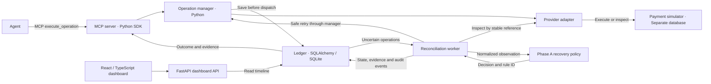

# Reconcile

Reconcile is a planned MCP reliability layer for agents that change external systems. A payment can commit even when its reply times out. Reconcile records the attempt before sending it, then checks the provider before deciding whether to retry.

## Phase A · Recovery policy

[recovery_policy.py](recovery_policy.py) implements the decision table in Python with no third-party dependencies. It returns an action and a stable rule ID that a future worker can record alongside provider evidence. The server, ledger, provider adapters and dashboard are planned.

| Provider observation | Phase A decision |
| --- | --- |
| Conclusive match | Verify the existing action |
| Pending, inconclusive or unavailable | Inspect again while the budget allows, then escalate |
| Conclusive absence | Retry if the original key can be reused or policy explicitly allows a retry without one |
| Mismatch or multiple matches | Escalate for human review |
| Conclusive rejection | Record failure |

```python
from recovery_policy import Observation, decide_recovery

decision = decide_recovery(Observation.EXECUTED_MATCHING, conclusive=True)
print(decision.action.value, decision.rule_id)
# verify execution_matches
```

## Planned architecture



1. **Accept the intent.** The MCP server accepts a caller-supplied intent ID and the action parameters. A unique operation key lets repeated submissions return the existing operation. Conflicting parameters for the same intent are rejected.
2. **Record before sending.** The manager stores the logical operation and an attempt before calling the adapter. Attempts reuse the original provider idempotency key where supported.
3. **Inspect uncertain outcomes.** A lost reply or interrupted attempt becomes `UNKNOWN`. The worker looks up the action independently using its stable reference. An early lookup miss can be inconclusive when the provider has delayed visibility.
4. **Apply the policy and verify.** The worker waits, verifies an existing action, retries when permitted, records a definitive failure, or parks the operation in `NEEDS_HUMAN`. Each decision records the rule ID and the evidence behind it.
5. **Return the result.** The agent retrieves status and evidence through MCP. The dashboard reads the same timeline through FastAPI.

### Storage and concurrency

The ledger will maintain current operation state, individual attempts and append-only events. SQLite is the initial MVP target. PostgreSQL is planned for concurrent reconciliation, with version checks on state transitions and expiring worker leases to recover abandoned work.

### MCP and adapters

The first MCP tools will be `execute_operation`, `get_operation` and `get_evidence`. The adapter contract will cover `execute`, `inspect`, `verify` and capability reporting. Payments come first, followed by bookings. Providers without a reliable lookup path require human review when the outcome remains unknown.

### Demo and extensions

The first demo will drop the reply after the payment simulator commits. A blind retry without idempotency can create a second charge. Reconcile will look up the first charge and return it. AWS hosting and RDS, with optional SQS, Lambda and CloudWatch, are planned. An ElevenLabs voice client is also planned as an MCP client.

Reconcile's safety depends on the provider's lookup and idempotency guarantees. Unresolved outcomes go to a person.
